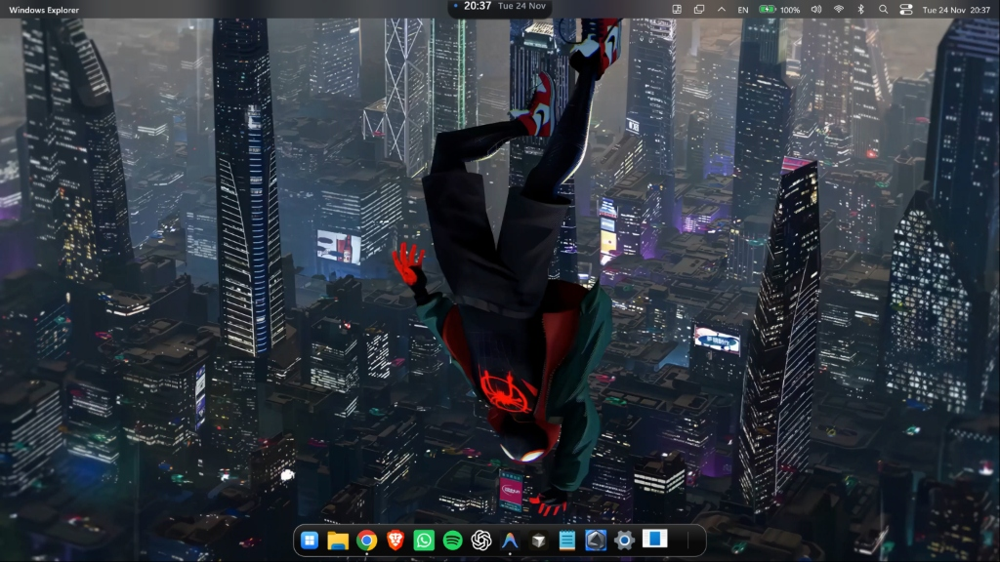

<div align="center">

# 🌊 Muelle Version 2

<p align="center">
  
</p>

<p align="center">
  <b>The ultimate macOS-inspired desktop environment for Windows 11.</b><br/>
  Featuring a fluid cursor-magnified dock, integrated <b>Notchpyx Dynamic Island</b>, top menu bar, and seamless window management.
</p>

<p align="center">
  <a href="#-features"></a>
  <a href="#-tech-stack"></a>
  <a href="#-dynamic-island"></a>
  <a href="#-performance"></a>
  <a href="LICENSE"></a>
</p>

---

### 🖥️ Full Desktop Experience Showcase

<br/>

<div align="center">
  
  <p><i>Muelle V2 in action: macOS Menu Bar + Notchpyx Dynamic Island at top, clean fluid Dock at bottom with live icons & custom apps.</i></p>
</div>

---

</div>

## 🌟 What's New in Version 2?

Muelle Version 2 bridges the gap between elegance and raw Windows productivity by seamlessly blending **Muelle's native glass dock** with **Notchpyx's Dynamic Island** and introducing a synchronized window-hierarchy launcher.

| Feature | Muelle V1 | Muelle V2 |
| :--- | :---: | :---: |
| **macOS Glass Dock** | ✅ | ✅ **Enhanced (Decluttered & Streamlined)** |
| **Dynamic Island HUD** | ❌ (Static text) | 🌟 **Integrated Notchpyx Dynamic Island** |
| **Top Menu Bar** | ✅ | ✅ **Unified with Island Z-Order Engine** |
| **Single-Click Unified Launcher** | ❌ | 🌟 **`MuelleLauncher.exe` (Persistent Window Pos)** |
| **Decluttered Dock Layout** | ❌ (Forced bin/downloads) | 🌟 **Clean pinned apps with zero clutter** |
| **Genie Minimize & Live Previews** | ✅ | ✅ **Refined 60 FPS transitions** |

---

## 🎬 Visual Tour & Highlights

<div align="center">

| 🪄 Genie Effect Minimize | 🔍 Fluid Magnification & Hover |
| :---: | :---: |
|  |  |
| *Accurate macOS-style window minimization into dock* | *Sub-pixel smooth cursor magnification with zero lag* |

| 🧭 Auto-Hide & Top Bar Integration | ⚡ Ultra-Low Memory Idle (~15 MB) |
| :---: | :---: |
|  |  |
| *Intelligent auto-hide on fullscreen apps & games* | *Native Rust implementation — no Electron overhead* |

</div>

---

## 🚀 Key Features

### 🏝️ 1. Notchpyx Dynamic Island Integration
- **Persistent Topmost HUD**: Top-center Dynamic Island stays beautifully in front of the macOS menu bar.
- **Interactive Widgets**: Clock, media playback controls, battery charging animations, network telemetry, and quick status alerts.
- **Smart Expansion**: Touch or click to expand into full control panels, auto-collapsing when idle.

### 🌊 2. macOS Glass Dock
- **Parabolic Magnification**: Smooth cursor-tracking magnification powered by Direct2D / DirectComposition.
- **Decluttered & Customizable**: Run with only the apps you love (VS Code, Chrome, Terminal, Spotify, WhatsApp) without forced system folders.
- **App Grouping & Fanning**: Drop apps onto one another to create folders; click to fan them out in macOS Launchpad style.
- **Live Window Thumbnails**: Hover over any multi-window app to view real-time live window previews with one-click switching.

### 🪄 3. True Genie Minimize Effect
- Uses native Win32 window hooking and custom vertex mesh transformations to fold windows down into their dock icons.
- Auto-restores standard Windows window transitions upon exit.

### 👑 4. Unified MuelleLauncher Engine
- **Single-click start**: Starts both Muelle Dock and Notchpyx DynamicBar concurrently.
- **Real-Time Z-Order Monitor**: Automatically resolves z-index conflicts between `MuelleMenuBar` and `DynamicBarIslandStage` using Win32 `SetWindowPos`, guaranteeing the island remains cleanly on top without flicker.
- **Graceful Shutdown**: Automatically restores the standard Windows taskbar if closed or on system sleep.

---

## 🏗️ System Architecture

```mermaid
graph TD
    Launcher["🚀 MuelleLauncher.exe\n(C# Win32 Background Supervisor)"]
    
    subgraph Core Components
        Dock["🌊 Muelle Dock\n(Rust + Win32/Direct2D)"]
        Menu["🪟 Muelle Menu Bar\n(Active App + Tray + Quotas)"]
        Notch["🏝️ Notchpyx DynamicBar\n(Interactive Dynamic Island HUD)"]
    end
    
    subgraph Windows 11 DWM Layer
        ZOrder["⚡ Dynamic Z-Order Manager\n(HWND_TOPMOST & HWNDPREV sync)"]
        DWM["🖥️ Desktop Window Manager (Glass/Mica)"]
    end

    Launcher -->|Spawns & Monitors| Dock
    Launcher -->|Spawns & Monitors| Notch
    Dock --> Menu
    Launcher -->|Z-Order Sync (150ms)| ZOrder
    ZOrder -->|Notch atop Menu| DWM
```

---

## 📥 Quick Start & Installation

### Option A: Pre-built Binary Setup

1. **Clone the Repository**:
   ```powershell
   git clone https://github.com/aryanpyx/Muelle-Version-2.git
   cd Muelle-Version-2
   ```

2. **Run via Unified Launcher**:
   - Launch `MuelleLauncher.exe` (or build from source using `launcher\build.bat`).
   - Muelle will hide the default Windows taskbar and bring up your new glass dock and Dynamic Island.

3. **Restore Windows Taskbar**:
   - Simply quit Muelle from the tray or press `Ctrl + Shift + Esc` to access Task Manager and terminate `muelle.exe`.
   - Or run:
     ```powershell
     .\muelle.exe --restore
     ```

---

### Option B: Building from Source

#### Prerequisites
- Windows 10 (1903+) or Windows 11
- [Rust toolchain](https://rustup.rs/) (MSVC)
- Node.js & pnpm (for web/settings components)
- .NET Framework 4.0+ (for `MuelleLauncher`)

#### 1. Build Muelle Dock (Rust)
```powershell
cargo build --release -p muelle
```

#### 2. Compile Unified Launcher
```powershell
cd launcher
.\build.bat
```

#### 3. Integrate Notchpyx
Place `DynamicBar.exe` and its supporting assets into a `notchpyx/` folder inside your build output directory, then execute `MuelleLauncher.exe`.

---

## ⚙️ Configuration & Customization

Muelle V2 stores its user configuration in `%APPDATA%\Muelle\config.json`.

```json
{
  "theme": "dark",
  "autohide": false,
  "magnification": true,
  "iconSize": 56,
  "magnifiedSize": 90,
  "showMinimized": false,
  "showRecents": false,
  "notchpyx": true,
  "menuBar": true
}
```

---

## ⌨️ Shortcuts & Controls

| Shortcut / Action | Function |
| :--- | :--- |
| `Win` (with taskbar hidden) | Opens Windows Start Menu seamlessly |
| `Click Active Dock Icon` | Minimizes / Restores window |
| `Hover Dock Icon` | Reveals live window thumbnail preview |
| `Click Dynamic Island` | Expands Dynamic Island into interactive controls |
| `Drag & Drop on Dock` | Pins app or opens file in target app |
| `Ctrl + C` (in CLI) | Clean shutdown & restores native Windows taskbar |

---

## 🧑‍💻 Credits & Acknowledgments

- **Aryan Pandey ([@aryanpyx](https://github.com/aryanpyx))**
  - Muelle Version 2 Architecture & Integration
  - Notchpyx Dynamic Island system
  - MuelleLauncher Z-Order Engine & Window Synchronization
  - Dock decluttering & custom icon styling
- **[crafter-station / Muelle](https://github.com/crafter-station/Muelle)**
  - Original Muelle dock core, Direct2D glass rendering, and Genie effect animations

---

<div align="center">

<b>Crafted with ❤️ by <a href="https://github.com/aryanpyx">Aryan Pandey</a></b><br/>
<sub>Give this repo a ⭐ if you love having a modern macOS aesthetic on Windows 11!</sub>

</div>
